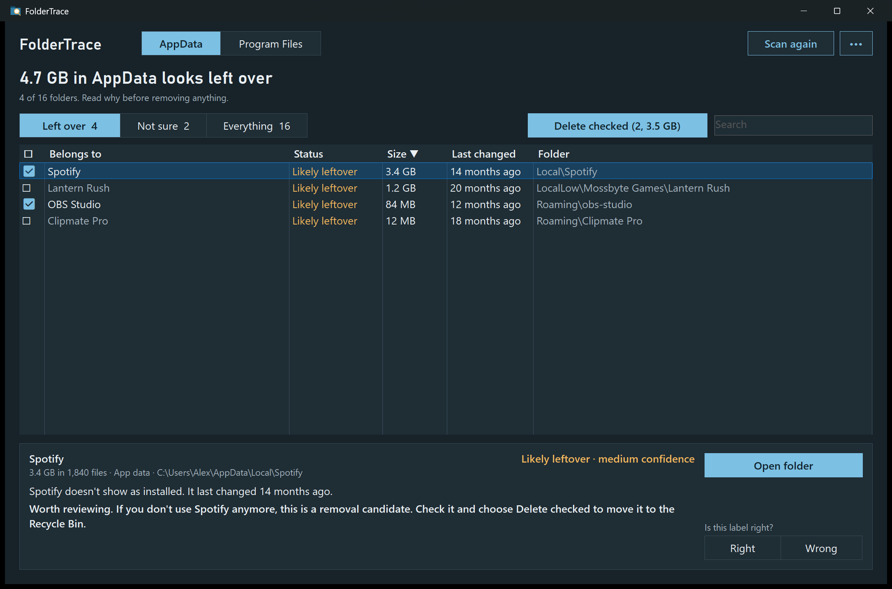

# FolderTrace

FolderTrace tells you which program each AppData folder belongs to, so you can find the ones left over from programs you uninstalled.

[Get it free on the Microsoft Store](https://apps.microsoft.com/detail/9NG4J9PKM2WC)



*The screenshot uses the built-in demo with sample data.*

## What it does

FolderTrace looks at what's installed, your game libraries, shortcuts, Windows' record of programs you've run, and small log and settings files. Then it labels every folder:

- **In use:** the program is still on your PC.
- **Likely leftover:** nothing on your PC uses it anymore.
- **Not sure:** FolderTrace can't tell, so it says so instead of guessing.
- **Windows or shared:** Windows folders and caches. These can't be selected for removal.

Every label shows the evidence behind it. It also checks Program Files.

## Safety

- Scanning never changes anything.
- Folders are only removed when you check them and choose Delete checked, and they go to the Recycle Bin so you can put them back.
- It warns you when a folder may hold game saves or sign-ins, and never opens browser data or files in folders tied to logins.
- It runs entirely on your PC. No internet, account, ads, or tracking.

The tests in `core_test.go` enforce this. They fail if the app code calls a delete, rename, or registry-write function anywhere except the Recycle Bin code, and they check that a scan leaves the disk unchanged.

## Build it yourself

You need Go 1.27.4 or newer.

```
GOOS=windows GOARCH=amd64 go build -ldflags "-H=windowsgui" -o FolderTrace.exe .
go test ./...
```

`packaging/build-msix.sh` builds the Microsoft Store package. Build with `-tags demo` to get the demo with sample data.

## Feedback

Found a bug or a folder with the wrong label? [Send feedback](https://flagpoleog.github.io/feedback/?app=foldertrace) or open an issue here.

## Privacy

[FolderTrace privacy policy](https://flagpoleog.github.io/foldertrace/privacy.html)

## More from Second Shift Software

FolderTrace is made by one person as [Second Shift Software](https://flagpoleog.github.io). Also check out [DropTrace](https://github.com/FlagPoleOG/DropTrace), a free internet outage logger.

## License

MIT
